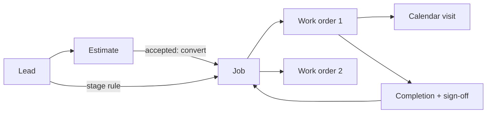

# Work orders plan

Status: **QA walkthrough complete** — October 19, 2026. All 20 questions decided (Q1–Q9 one by one, Q10–Q20 in bulk) and every requirement row has a status. Walked like [customers-page-plan.md](customers-page-plan.md), [leads-page-plan.md](leads-page-plan.md), [calendar-page-plan.md](calendar-page-plan.md) and [estimates-page-plan.md](estimates-page-plan.md).
Scope: what a work order is in SalesMora, how it relates to leads, estimates, jobs and the calendar, its lifecycle, the crew-facing document, the office-facing list and record pages, field completion and sign-off, permissions, the assistant, and delivery order.

## How to use this document

1. Start with §2 (the concept) and §12 (open questions). Q1–Q4 shape everything else, so decide them first.
2. Walk §6 by group. Each requirement has an ID and a blank **Decision / Status** cell (Agreed / Changed / Deferred / Rejected).
3. Decisions are recorded in the requirement rows and in §12.
4. Prototypes are updated after the walkthrough, not before.

**Prototypes (October 19, 2026):** `prototype/prototype-screen-35-work-orders.html` (list), `prototype-screen-36-work-order.html` (record, new/draft, Field preview, complete, print) and a Work orders card on `prototype-screen-12-job-detail.html`.

**Inherited decisions (do not re-decide):** numbered pages 25/50/100; export is a streaming CSV with a 50,000-row cap, default Owner/Admin; delete is confirmed by typing the record number; assistant drafts are confirmed on a card; sorting/filtering from chat uses "open in list" links; `actionType` is the discriminator; `recordRefs` types extend to include `work_order`; shared per-user notification preferences; integer cents for money; workspace timezone for dates.

---

## 1. Current state

- Work-order requirements and prototypes are defined below; no work-order contracts, tables, services or live UI are implemented yet.
- **Jobs** are live locally (`/jobs`, `/jobs/[jobId]`, `docs/jobs.md`): statuses Needs Scheduling, Scheduled, In Progress, Waiting, Completed, Canceled; one primary owner plus optional job team; immutable text progress notes and activity. Attachments and team chat are pending services. The earlier Phase 2 per-job checklist is superseded by work-order tasks (see [job-module-plan.md](job-module-plan.md) in-job journey 9).
- **Estimates** (planned): priced, customer-facing, parent is one lead or job; accepted estimates can convert to a job.
- **Calendar** (planned): week view of job visits with arrival windows.
- **Permissions:** `jobs.*` exist; Field sees assigned jobs only; Field `jobs.schedule.update` is primary owner only.
- **Assistant:** one query tool and one propose tool per domain (`customers_query`/`customers_propose_action`, planned `estimates_*`).

The gap: a job says *what the business agreed to do*; nothing tells the crew *exactly what to do on site, with what, and proves it was done*.

## 2. What a work order is (proposed concept)

A **work order** is the crew-facing, internal instruction and completion record for performing work. It is usually priceless, printable/mobile-friendly, and ends in a signed-off result.

| | Estimate | Job | Work order |
|---|---|---|---|
| Audience | Customer | Office and assigned team | Crew (and customer for sign-off) |
| Answers | What will it cost? | What are we doing, who owns it, when? | What exactly do I do on site, and was it done? |
| Money | Yes | Summary only | No prices by default |
| Lifecycle | Draft → decided | Needs Scheduling → Completed | Draft → Issued → In progress → Completed |
| Printable | Yes (customer paper) | No | Yes (crew paper) |

Proposed relationship: **a job has zero or more work orders; a work order belongs to exactly one job.** A simple job can auto-generate one work order; a multi-visit or multi-trade job can have several (phases, trades, return visits).

## 3. Design and architecture

### 3.1 Routes (proposed)

| Route | Purpose |
|---|---|
| `/work-orders` | List (office); Field sees assigned only |
| `/work-orders/new?jobId=` | Create from a job |
| `/work-orders/[workOrderId]` | Record page: details, tasks, materials, photos, notes, history |
| `/work-orders/[workOrderId]/print` | Crew-ready printable (US Letter) |
| `/jobs/[jobId]` | New "Work orders" card listing and creating work orders |
| `/e/[token]`-style public link | Only if Q9 enables customer sign-off by link |

### 3.2 Page layout

- List: metrics row, search, filters (status, assignee, job, date), sort, numbered pager, export — same pattern as Estimates/Customers.
- Record page: header (number, status, job link, customer, address), crew and schedule card, **Tasks** (checklist), **Materials and equipment**, **Instructions and safety**, **Photos and files**, **Time and notes**, **Completion and sign-off**, history.
- Mobile-first record view for Field users (large tap targets, offline-tolerant drafts deferred).

### 3.3 Server structure

Follows the existing feature layout: `apps/web/src/features/work-orders/*`, `apps/web/src/server/work-orders/*`, contracts in `packages/contracts`, assistant tools `work_orders_query` and `work_orders_propose_action`.

## 4. Data model (additive; depends on jobs)

| Table | Key fields |
|---|---|
| `work_orders` | id, workspace_id, job_id, number (`WO-####`, per workspace), title, status, instructions, safety_notes, access_notes, scheduled_start/end (or visit link), primary_assignee_id, estimate_id (nullable source), created_by, issued_at, started_at, completed_at, canceled_at, archived_at |
| `work_order_tasks` | id, work_order_id, position, label, done, done_by, done_at, required |
| `work_order_materials` | id, work_order_id, name, quantity, unit, status (needed/ordered/on hand/used), note |
| `work_order_assignees` | work_order_id, user_id (optional crew beyond the primary) |
| `work_order_attachments` | reuse the job attachment storage with a work_order_id reference |
| `work_order_signoffs` | id, work_order_id, signer_name, method, signed_at, signature_ref, note |
| `work_order_events` | append-only history: actor, type, from/to, note, timestamp |

Rules: parent job must be in the same workspace; numbers are never reused; completed work orders are immutable except through Reopen; all reads are scoped by SQL before counts or records.

## 5. Storybook plan

Components (kebab-case folders with `.tsx`, `.data.ts`, `.stories.tsx`): `work-orders-list`, `work-order-status-badge`, `work-order-header`, `work-order-task-list`, `work-order-materials`, `work-order-instructions-card`, `work-order-crew-card`, `work-order-photos`, `work-order-signoff`, `work-order-print-paper`, `job-work-orders-card`, `create-work-order-dialog`.
Page stories: list (empty, loading, error, 100 rows), record in each status, Field mobile view, print paper. Each component is approved in Storybook before the next one starts.

---

## 6. Requirements checklist (QA walkthrough)

### 6.1 Access and permissions (ACC)

| ID | Requirement | Decision / Status | Notes |
|---|---|---|---|
| ACC-1 | `/work-orders` and APIs require a session and `workorders.read`; nav item only with that permission | Agreed | Q8 |
| ACC-2 | Owner/Admin/Office read all; Field reads work orders on jobs they can access (assigned) | Agreed | |
| ACC-3 | New permissions proposed: `workorders.read/create/update/issue/complete/cancel/reopen/archive/delete/export` | Agreed | Q8 |
| ACC-4 | Field may update tasks, materials used, notes and photos, and complete work orders they are assigned to; cannot edit instructions or reassign | Agreed | Built: a work order's own assignee and crew count as assigned, even when not on the job team (non-draft only) |
| ACC-5 | Server re-checks every action; forged ids and cross-workspace ids return 404 | Agreed | |
| ACC-6 | Buttons hidden or disabled with a reason; permission changes apply without re-login | Agreed | |
| ACC-7 | Customer details on a work order use the minimal related DTO for Field | Agreed | |

### 6.2 List (WOL)

| ID | Requirement | Decision / Status | Notes |
|---|---|---|---|
| WOL-1 | Columns: number, title, customer, job, status, assignee, scheduled date, task progress (3/7), updated | Agreed | |
| WOL-2 | Search by number, title, customer, job number, address | Agreed | |
| WOL-3 | Filters: status, assignee, scheduled range, job; chips and Clear all | Agreed | |
| WOL-4 | Sort: scheduled date (default), updated, number | Agreed | Q10 |
| WOL-5 | Numbered pagination 25/50/100 | Agreed | Inherited |
| WOL-6 | Metrics: Issued today, In progress, Overdue, Awaiting sign-off | Agreed | |
| WOL-7 | Empty, no-match, loading and error states | Agreed | |
| WOL-8 | Row menu: Open, Print, Duplicate, Cancel, Archive | Agreed | |
| WOL-9 | "My work orders" quick view for Field and anyone assigned | Agreed | |
| WOL-10 | Export CSV of the filtered set (inherited rules) | Agreed | |

### 6.3 Creation (CRE)

| ID | Requirement | Decision / Status | Notes |
|---|---|---|---|
| CRE-1 | Create from a job ("Add work order"); a work order cannot exist without a job | Agreed | Q1 |
| CRE-2 | Auto-create one draft work order when a job is created or an estimate is converted (setting, default off/on) | Agreed: off by default (Q2) | Q2 |
| CRE-3 | When created from an accepted estimate, copy line items as tasks/materials **without prices**; staff reviews before issue | Agreed | Q3 |
| CRE-4 | Prefill title, customer, address, contact and service type from the job | Agreed | |
| CRE-5 | Templates per service type (task list, materials, safety text) | Deferred: templates in slice 8 (Q17) | Q5 |
| CRE-6 | Duplicate an existing work order (new number, Draft, no completion data) | Agreed | |
| CRE-7 | Assistant can draft a work order from a job description; the user reviews on a card | Agreed | |
| CRE-8 | Numbering `WO-####` per workspace, race-safe, never reused | Agreed | |

### 6.4 Lifecycle and status (LIF)

| ID | Requirement | Decision / Status | Notes |
|---|---|---|---|
| LIF-1 | Statuses: Draft, Issued, In progress, Completed, Canceled; Archived as a flag | Agreed | Q4 |
| LIF-2 | Draft is editable and invisible to Field; Issue makes it visible to assignees and notifies them | Agreed | |
| LIF-3 | Starting work (first task checked, or Start button) moves Issued → In progress and records the actor and time | Agreed | |
| LIF-4 | Completion requires required tasks done (or an override with reason by office) and, if enabled, sign-off | Agreed | Q9 |
| LIF-5 | Completing the last open work order on a job **suggests** (never forces) completing the job | Agreed: suggest only (Q6) | Q6 |
| LIF-6 | Cancel needs a reason; Reopen restricted to office roles and preserves checkmarks | Agreed | |
| LIF-7 | Issued content changes are allowed but logged, with a "changed after issue" notice to the crew | Agreed (Q7) | Q7 |
| LIF-8 | Overdue is derived from the scheduled end, not a stored status | Agreed | |
| LIF-9 | Every transition records from/to, actor, timestamp and note in history | Agreed | |

### 6.5 Crew-facing content (CNT)

| ID | Requirement | Decision / Status | Notes |
|---|---|---|---|
| CNT-1 | Instructions: plain text with simple formatting, size limit | Agreed | |
| CNT-2 | Tasks: ordered checklist, optional "required" flag, reorderable, check/uncheck with actor and time | Agreed: replaces job checklist (Q5) | Q5 |
| CNT-3 | Materials and equipment list with quantity, unit and status. Crew never see prices or costs | Agreed | Q11 |
| CNT-3a | Items can link to a workspace **materials catalog** (name, unit, SKU, supplier, internal cost, customer price) or be free text. Linking copies name and unit and snapshots cost and price; later catalog changes do not alter existing work orders | Agreed (revised after Q15) | Q15 |
| CNT-3b | Office with price access can override the customer price per work order item without changing the catalog; line and materials totals shown | Agreed | Q15 |
| CNT-3c | Internal cost and margin need a separate cost-visibility permission; prices and costs are never on the crew sheet or print | Agreed | Q15 |
| CNT-4 | Safety and access notes (gate code, pets, hazards) as a highlighted block | Agreed | Privacy: access codes are sensitive |
| CNT-5 | Photos before/after and files; image types and size limits shared with jobs | Agreed | |
| CNT-6 | Customer contact shown with call/text/navigate links for assignees | Agreed | |
| CNT-7 | Crew notes (append-only) distinct from job progress notes | Agreed | |
| CNT-8 | Prices, margins and internal estimate notes never appear on the crew view or print | Agreed | |

### 6.6 Assignment and scheduling (ASG)

| ID | Requirement | Decision / Status | Notes |
|---|---|---|---|
| ASG-1 | One primary assignee plus optional crew; defaults from the job owner | Agreed | Q12 |
| ASG-2 | Assignee must be an active workspace member; removed members are unassigned with a history entry | Agreed | |
| ASG-3 | Schedule by linking to a calendar visit or by its own date/window | Agreed | Q13 |
| ASG-4 | Rescheduling follows `jobs.schedule.update` rules (Field primary-owner exception) | Agreed | |
| ASG-5 | Assignment changes notify the new and previous assignee | Agreed | |
| ASG-6 | Assigned crew sees the work order in "My work orders" and on the Home widgets | Agreed | |

### 6.7 Completion and sign-off (SGN)

| ID | Requirement | Decision / Status | Notes |
|---|---|---|---|
| SGN-1 | Completion form: summary of work done, tasks status, materials used, photos, optional follow-up needed | Agreed | |
| SGN-2 | Optional customer sign-off: on-device signature with printed name | Agreed | Q9 |
| SGN-3 | Sign-off stores signer, time, method and an image reference; stored privately, never public | Agreed | |
| SGN-4 | Remote sign-off by emailed tokenized link | Deferred: remote link later (Q9) | Q9 deferred? |
| SGN-5 | "Follow-up needed" can create a new work order or job note | Agreed | |
| SGN-6 | Completed work orders are read-only; the PDF/print includes sign-off | Agreed | |
| SGN-7 | Time tracking (start/stop or manual hours) | Deferred (Q14) | Q14 |

### 6.8 Print and share (PRT)

| ID | Requirement | Decision / Status | Notes |
|---|---|---|---|
| PRT-1 | Print-ready US Letter crew sheet with business header, job, address, tasks with checkboxes, materials, safety, notes space | Agreed | |
| PRT-2 | No prices on the print unless explicitly enabled | Agreed | Q11 |
| PRT-3 | Print and Save as PDF only in the first slice; email-to-crew later | Agreed (Q18) | |
| PRT-4 | Print uses the same data as the record page and respects permissions | Agreed | |

### 6.9 Integration with jobs, estimates, calendar (INT)

| ID | Requirement | Decision / Status | Notes |
|---|---|---|---|
| INT-1 | Job detail gets a Work orders card with status counts and a create button | Agreed | |
| INT-2 | Job list shows an "open work orders" count; filter jobs with work orders | Agreed | |
| INT-3 | Estimate shows linked work orders after conversion | Agreed | |
| INT-4 | Calendar cards show a work-order marker; the peek drawer links to it | Agreed | Calendar plan |
| INT-5 | Job progress timeline shows work-order events | Agreed | |
| INT-6 | Customer record lists work orders through its jobs | Agreed | |
| INT-7 | Reports: work orders completed, average completion time, overdue | Deferred | Later |

### 6.10 Notifications (NTF)

| ID | Requirement | Decision / Status | Notes |
|---|---|---|---|
| NTF-1 | Notify assignees on Issue, reassignment, reschedule and post-issue changes | Agreed | Built (in-app bell) |
| NTF-2 | Notify the job owner and office on Completed, Canceled and sign-off | Agreed | Built (in-app); assignees are also told on Cancel. Sign-off arrives with Completed |
| NTF-3 | Overdue reminder to the assignee and job owner | Agreed | Not built: needs a scheduled job |
| NTF-4 | All use the shared per-user notification preferences | Agreed | Inherited. In-app only so far; no work-order email, so no preference yet |
| NTF-5 | Notifications contain no access codes or sensitive notes | Agreed | Built: only event, actor, number and title are stored or shown |

### 6.11 Export and data rules (EXP)

| ID | Requirement | Decision / Status | Notes |
|---|---|---|---|
| EXP-1 | Export columns: number, title, job, customer, status, assignee, scheduled, completed, task counts | Agreed | |
| EXP-2 | Needs `workorders.export`; authorized scope only; CSV injection-safe | Agreed | |
| EXP-3a | List-page Export button downloads the current filters as CSV (all columns), shown only with `workorders.export` | Built | `POST /api/work-orders/export` |
| EXP-3 | Retention and deletion follow job rules; sign-off images deleted with the work order | Agreed | |
| EXP-4 | Account/workspace deletion removes work orders and files | Agreed | |

### 6.12 Quality (QLT)

| ID | Requirement | Decision / Status | Notes |
|---|---|---|---|
| QLT-1 | Accessible: keyboard operable, labelled controls, focus management in dialogs | Agreed | |
| QLT-2 | Mobile-first record view, tested at 375 px | Agreed | |
| QLT-3 | Idempotent create (auto-create on estimate conversion never duplicates) | Agreed | |
| QLT-4 | Optimistic concurrency: two people editing tasks do not overwrite each other | Agreed | |
| QLT-5 | Unit, API, permission-matrix, and browser tests for each slice | Agreed | |
| QLT-6 | Storybook states for loading, empty, error and long content | Agreed | |

---

## 7. Component and data flow

1. Job (or accepted estimate) → Create work order (draft) → office reviews and Issues.
2. Issue → notification → crew opens the mobile record or the print sheet.
3. Crew checks tasks, logs materials, attaches photos, adds notes.
4. Crew (or office) completes; optional customer sign-off.
5. Completion event → job timeline entry and a suggestion to complete the job (never automatic).

## 8. Events, audit, notifications

Events: `work_order.created/issued/started/task_toggled/completed/canceled/reopened/reassigned/rescheduled/signoff_recorded/archived`. All are append-only in `work_order_events` with actor and timestamp; no sensitive access notes in event payloads.

## 9. Work orders in the shared assistant

Tools: `work_orders_query` (read/search/summaries, "open in list" links) and `work_orders_propose_action` (every write is a confirmed card).

| User says | Assistant behavior |
|---|---|
| "What's on my plate tomorrow?" | Lists the user's work orders with times and links |
| "Create a work order for the Lee kitchen job" | Drafts from the job (and accepted estimate, unpriced), shows a card to confirm |
| "Add a task: cap the water line" | Proposes a task add card |
| "Mark the demo task done" | Confirms the specific task, then updates |
| "Assign WO-1004 to Sam" | Assignment card, permission-checked |
| "Which work orders are overdue?" | Summary plus an open-in-list link |
| "Complete WO-1004" | Shows open required tasks first; confirms; never fakes a signature |

Rules: the assistant never invents materials or quantities silently (they are marked as suggestions), never reveals access codes in chat history by default, never signs off for a customer, and respects the same permissions as the UI. `recordRefs` types become `lead | customer | job | estimate | work_order` (also recorded in context-aware-agent-architecture.md), with surface keys `work_order.list` and `work_order.detail`; `actionType` stays the discriminator.
**Delivery status.** Slice 7a is built: the read-only `work_orders_query` tool (`search`, `details`) on every surface, plus the `work_order.list` and `work_order.detail` surface keys. It is permission-checked with `workorders.read` and never returns access notes, prices, costs or contact details. Slice 7b is built: `work_orders_propose_action` (create, edit, schedule, assign, add tasks, toggle task, add materials, set status, complete, reopen, add note, CSV export) produces a review card (`WorkOrderDraftCard`) that the user confirms by button only; the server re-authorizes at confirm time, drafts expire after 15 minutes, and the open work order is passed as a `work_order` record ref. CSV export is audited and never includes access notes, prices or costs. Customer signatures cannot be captured from chat.

## 10. Testing plan

Unit: status transitions, numbering, permission matrix, price-stripping from estimate conversion. API: scoped reads for Field, forged ids, concurrency. UI: Storybook states, mobile viewport, print layout. Browser: create → issue → complete → sign-off flow. Assistant: tool authorization and confirmation tests.

## 11. Delivery sequence (one reviewed slice at a time; Storybook approval before the next component)

1. Contracts, permissions, migration and read model.
2. List and record page (read-only) in Storybook, then live.
3. Create/edit/issue for office users from a job.
4. Crew experience: tasks, materials, photos, notes, mobile view.
5. Completion, sign-off, print.
6. Notifications, calendar and estimate integration.
7. Assistant tools.
8. Templates, time tracking, remote sign-off (if not deferred).

## 12. Open questions (decide in QA)

| # | Question | Options / recommendation | Decision |
|---|---|---|---|
| Q1 | What is the parent of a work order? | Exactly one job; a job can have many (**recommended**) / one work order per job / allow estimate or lead parents | Agreed: one job, many work orders |
| Q2 | Auto-create work orders? | Off by default; workspace setting "Create a draft work order when a job is created from an accepted estimate" (**recommended**) / always / never | Agreed: off by default; workspace setting |
| Q3 | Estimate → work order | Copy line items as unpriced tasks/materials for review (**recommended**) / copy nothing / copy with prices for office only | Agreed: unpriced tasks/materials for review |
| Q4 | Status set | Draft, Issued, In progress, Completed, Canceled + Archived flag (**recommended**) / reuse job statuses / add On hold | Agreed |
| Q5 | Checklist vs. job checklist | Work-order tasks are the checklist; the job Phase 2 checklist is replaced or becomes the default template (**recommended: unify**) / keep both separately | Agreed: unify; replaces the job Phase 2 checklist |
| Q6 | Effect on job status | Suggest only (**recommended**) / auto-start job when a work order starts / auto-complete when all are complete | Agreed: suggest only |
| Q7 | Editing after Issue | Allowed with logged change and crew notice (**recommended**) / immutable with Revise like estimates / allow only notes | Agreed: allowed, logged, crew notice |
| Q8 | Permission model | New `workorders.*` set with Field on assigned (**recommended**) / reuse `jobs.*` permissions | Agreed: new workorders.* set |
| Q9 | Customer sign-off | Optional per workspace; on-device signature in slice 1; remote link later (**recommended**) / required always / defer entirely | Agreed: optional per workspace; on-device first, remote link later |
| Q10 | Default list sort | Scheduled date soonest first (**recommended**) / updated | Agreed (bulk) |
| Q11 | Prices on work orders | Never shown to crew; optional office-only budget later (**recommended**) / show per-task price | Agreed (bulk) |
| Q12 | Crew model | Primary assignee plus optional crew (**recommended**) / primary only / multiple equal assignees | Agreed (bulk) |
| Q13 | Scheduling | Work order links to a calendar visit; no separate date model (**recommended**) / own dates | Agreed (bulk) |
| Q14 | Time tracking | Defer; manual hours only later (**recommended**) / start-stop timer now | Agreed (bulk): deferred |
| Q15 | Materials | Free-text list with status, no inventory (**recommended**) / link to a catalog / full inventory | Revised: link to a materials catalog with internal cost and customer price; office-only pricing, crew see no prices. Catalog pages built later; free text stays allowed |
| Q16 | Offline use | Defer; online only (**recommended**) / limited offline drafts | Agreed (bulk): deferred |
| Q17 | Templates by service type | Slice 8 (**recommended**) / slice 2 | Agreed (bulk): slice 8 |
| Q18 | Print only vs. PDF/email | Print/Save as PDF only (**recommended**) / server PDF and email to crew | Agreed (bulk) |
| Q19 | Who can complete? | Assigned crew and office (**recommended**) / office only | Agreed (bulk) |
| Q20 | Naming in the UI | "Work orders" (**recommended**) / "Tasks sheets" / "Service tickets" | Agreed (bulk) |

## 13. Risks

- Overlap with job checklists and progress notes: mitigate by Q5 and by clear "crew vs. office" copy.
- Sensitive access notes leaking through chat, email or logs: mark as sensitive, exclude from notifications and chat history.
- Price leakage from estimate conversion: strip prices in the conversion function and test it.
- Scope creep into dispatch, inventory, invoicing and time tracking: explicitly deferred.
- Signature storage and legal weight: store as acknowledgment only; no legal-signature claims.

## 14. Acceptance summary (definition of done)

- Office can create, issue, track and complete work orders for any job; Field can complete assigned ones from a phone.
- No prices or sensitive notes reach the crew view, print, notifications or logs.
- Permissions, history, numbering, idempotency and concurrency are tested.
- The assistant can query and propose every action through confirmed cards.
- Storybook states and prototypes match the agreed decisions.

## Cleanup delivery note

Built after slice 7b: the list-page CSV export button; deleting draft work orders (`workorders.delete`, typed number confirmation, minimal `workOrderDeleteAudit` row, list row menu and detail header; assistant deletion deliberately not offered); workspace settings at `/settings/work-orders` (owner/admin via `settings.business.update`) holding "Require customer sign-off" (enforced server-side on completion and shown in the sign-off UI) and the business phone printed on crew sheets; and the customer phone on the work order contact card.
